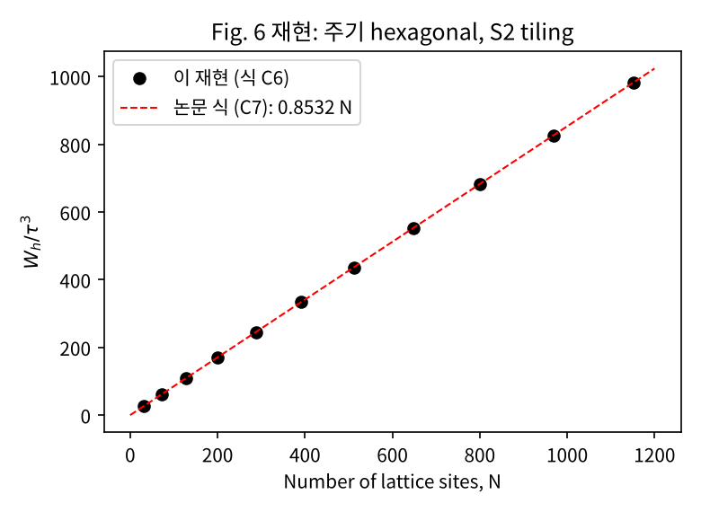

# 26-2 QIYA Project

**주제:** 2D SSH 모델의 Hamiltonian simulation. 논문의 tile 분해로 Hamiltonian을 나누고, 각 tile의 시간 진화를 qDRIFT로 조합해요.

**메인 논문:** A. J. Bay-Smidt et al., *Fault-Tolerant Quantum Simulation of Generalized Hubbard Models*, [PRX Quantum 6, 030348 (2025)](https://doi.org/10.1103/gr4t-b1w5)

| 폴더 | 내용 |
|---|---|
| [`tile_trotterization/`](tile_trotterization) | 메인 논문의 tile Trotterization 구현과 결과 재현 |

---

## Tile Trotterization 재현

Bay-Smidt et al., *Fault-Tolerant Quantum Simulation of Generalized Hubbard Models*, PRX Quantum 6, 030348 (2025)

### 실행

```bash
pip install numpy scipy matplotlib networkx
cd tile_trotterization
python3 r1_tiles.py        # tile 회로와 Table I
python3 r2_hexagonal.py    # hexagonal S2 tiling과 step당 게이트 수
python3 r3_Wh.py           # Fig. 6, 식 (C7)  -> fig6_reproduction.png
python3 r4_end_to_end.py   # 게이트 수준 Trotter step 오차 vs bound (약 25초)
```

각 스크립트의 실행 결과는 `r*_output.txt`에 저장돼 있어요.

### 파일

| 파일 | 내용 |
|---|---|
| [`tile_trotter.py`](tile_trotterization/tile_trotter.py) | 라이브러리: Clifford+T+Rz 시뮬레이터, F 게이트, tile 회로, JW 순서를 추적하는 `FermionCircuit`, 격자와 tiling, 오차 계수 |
| [`r1_tiles.py`](tile_trotterization/r1_tiles.py) | 재현 1: App. A tile 회로, Table I / III |
| [`r2_hexagonal.py`](tile_trotterization/r2_hexagonal.py) | 재현 2: App. D tiling, 식 (27)–(28), (E12)–(E13) |
| [`r3_Wh.py`](tile_trotterization/r3_Wh.py) | 재현 3: Fig. 6, 식 (C7) |
| [`r4_end_to_end.py`](tile_trotterization/r4_end_to_end.py) | 재현 4: 식 (20)–(21)을 게이트 수준으로 검증, 2D SSH 적용 |

### 결과 요약

| 논문 항목 | 논문 값 | 재현 값 | 비고 |
|---|---|---|---|
| F 게이트 비용 (Fig. 5b) | T 2개 | T 2개 | Clifford+T 분해를 직접 찾음 |
| S1 / S2 / C4 / S4 비용 (Table I) | 회전 2, T 0 / 4 / 8 / 12 | 동일 | 회로 = $e^{-iHt}$ 정확히 일치 |
| S4 fswap (Table III) | 2 | 2 | |
| hexagonal tiling (App. D) | 섹션당 S2 $N/4$개 | 동일 ($L$ = 4–24) | Fig. 7(b)에서 색 배치 규칙을 읽어냄 |
| step당 비용, Hubbard (E12–E13) | $N_R = 6N,\ N_T = 10N$ | 동일 | |
| step당 비용, extended (27–28) | $N_R = 12N,\ N_T = 10N$ | 동일 | |
| $W_h$, $L = 8$ (Table II 캡션) | 108.6 | 108.617 | |
| 식 (C7) | $W_h \le 0.8532\,\tau^3 N$ | 최대 0.8532 ($L = 6$) | 소수점 넷째 자리까지 일치 |
| Fig. 6 | 선형, $N = 1152$에서 약 980 | 981.3 | [그림](tile_trotterization/fig6_reproduction.png) |
| 식 (21) bound | $\lVert U - S\rVert \le (W_{SO2} + W_h)t^3$ | 성립, 실제 오차는 bound의 55–73% | 벤젠 고리, $t \to 0$에서 기울기 3.00 |



### 구현 메모

- **규약:** $\lvert 1\rangle$ = 점유, $a_j = Z_0\cdots Z_{j-1}Q_j$. 논문과는 F 게이트의 라벨과 부호만 달라요(합 모드를 놓는 쪽을 `sum_to`로 지정).
- **CNOT 수:** Table III보다 조금 많아요. 논문은 $XX$와 $YY$ 회전을 한 회로로 합쳤어요(Fig. 5c). Clifford라서 논문의 비용 척도에는 영향이 없어요.
- **fswap:** 논문은 섹션 사이의 JW 순서 변경 비용을 세지 않았어요. 여기서는 `FermionCircuit`이 인접 fswap으로 tile을 연속 위치에 모으고, 마지막에 원래 순서로 복귀시켜요. 벤젠 고리에서는 step당 32개, 2D SSH 4×4에서는 92개였어요. 최적화는 하지 않았어요.
- **$W_h$:** 자유 페르미온 공식(식 C6, 단일입자 인접행렬의 Schatten-1 노름)을 써요. `W_eq15`는 식 (15)를 항으로 쪼개지 않은 버전이라 더 작게(촘촘하게) 나와요.
- **오차 노름:** (N↑, N↓) 섹터별로 정확히 계산했어요(Hamiltonian이 둘 다 보존해서 섹터별 최댓값 = 전체 노름).

### 재현하지 않은 것

- **$W_{SO2}$ (식 31–32, Table II)** — 128-site 격자에서 DMRG로 계산한 교환자 bound라서 범위 밖이에요. 작은 계(벤젠 고리)에서는 정확한 값으로 대신 검증했어요.
- **Sec. V–VI (qubitization, QPE 자원 추정)**
- **Hamming weight phasing:** 공식만 있고 회로는 구현하지 않았어요.

### 2D SSH 적용 (`r4_end_to_end.py`, 계 B)

4×4 열린 경계, $t_1 = 0.5$, $t_2 = 1.0$이에요.
- 섹션 $t_1$: C4 4개
- 섹션 $t_2$: C4 1개 + S1 4개 (tile 섞기)

행 순서 JW에서 게이트 수준 회로가 섹션 곱과 정확히 일치해요. 자유 페르미온이라 정확한 다체 오차 노름 $\lVert U - S\rVert$를 단일입자 행렬로 계산할 수 있어요. 결과는 상태 오차 ≤ $\lVert U - S\rVert$ ≤ $Wt^3$ 순서로 성립해요.
